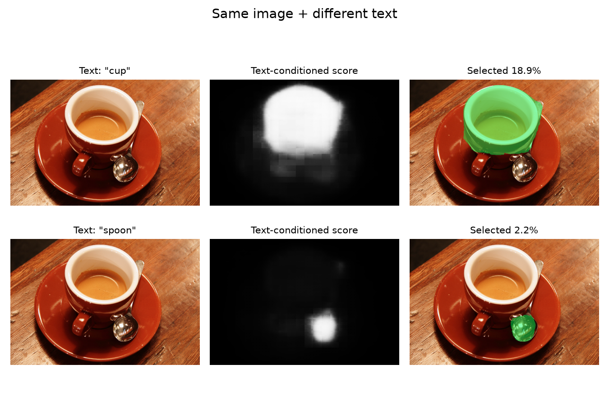

# Image Encryption

Text-guided reversible image protection using CLIPSeg and a learned linear transform.

The program selects an object from an English text prompt, transforms only its predicted
region, saves the protected data and a separate key, and reconstructs the original RGB
pixels in a fresh Python process. It runs on a CPU; no GPU is required.

This is an Advanced Image Processing term project by Hyun Jun Yook. The linear transform
is an educational method for reversible visual concealment. Its cryptographic security
has not been established.

## Quick start

```bash
git clone https://github.com/p6trick/Image-Encryption.git
cd Image-Encryption
conda env create -f environment.yml
conda activate school
python -s download_model.py
python -s main.py
```

If the `school` environment already exists, activate it and install missing dependencies
with `python -s -m pip install -r requirements.txt`.
Python 3.11 and CPU-only PyTorch are used. Execution was verified on Linux; Windows and
macOS were not independently tested.

The default demo selects `cup` in the coffee image. Results are written to `results/demo/`.
Open this repository in VS Code or PyCharm, select the `school` interpreter, and run
`main.py` without arguments to start the same demo.

Model weights are not committed to Git. `download_model.py` downloads the fixed checkpoint
revision into `models/clipseg/`. Once dependencies and model files are available, the
demo runs offline. RefCOCO evaluation also runs offline after its 20 images and annotations
have been downloaded on the first evaluation run.

## Commands

Run commands from the repository root.

```bash
# Default cup demo: segmentation, matrix training, protection, saving and reconstruction
python -s main.py

# Process an image with an English prompt
python -s main.py run --image inputs/coffee.png --text spoon --output-dir results/my_spoon

# Change the text for the same image
python -s main.py compare --image inputs/coffee.png --texts cup spoon --output-dir results/cup_vs_spoon

# Run all six demonstration images
python -s main.py examples

# Evaluate the fixed 20-image RefCOCO sample using category words
python -s main.py benchmark

# Evaluate the same sample using original referring expressions
python -s main.py benchmark --prompt-mode original

# Compare the two benchmark runs
python -s main.py compare-benchmarks

# Reconstruct from saved data and key without loading the source image or CLIPSeg
python -s main.py restore --protected results/demo/protected.npz --key results/demo/key.npz --output results/demo/restored_again.png

# Check matrix updates, disk round trips, invalid keys and invalid masks
python -s main.py verify
```

Add `--threshold 0.4`, for example, to `run` or `compare` to change the segmentation threshold.
The RefCOCO pilot uses a fixed threshold of 0.5. Its word mapping supports the seven
categories in the fixed seed-42 sample; extend `CATEGORY_WORDS` in `evaluate_refcoco.py`
before evaluating other categories.

## Text-conditioned selection

The text is passed to the CLIPSeg text encoder and affects the predicted mask.
The following example uses `cup` and `spoon` on the same photograph:



CLIPSeg is used without additional training. A separate 224-by-224 matrix is trained with
`Adam(en_model.parameters())` to minimize the orthogonality loss. Selected RGB values are
grouped into blocks of 224, transformed, and saved with all transformed padding values.
The unselected background is preserved. Reconstruction solves `Ux = y` rather than
assuming that the matrix transpose is an exact inverse.

## Output files

| File | Purpose |
|---|---|
| `original.png` | EXIF-corrected RGB image at its original dimensions |
| `probability.npy`, `probability.png` | Text-conditioned score map |
| `mask.png` | Predicted region used for protection |
| `ground_truth.png` | Evaluation-only target for RefCOCO |
| `protected.npz` | Signed floating-point values, background, predicted mask and transformed padding |
| `key.npz` | Learned transformation matrix |
| `protected.preview.png` | Display-only preview; not a reconstruction input |
| `restored.png` | Reconstructed RGB image |
| `comparison.png`, `gallery_*.png` | Visual comparisons |
| `metrics.json`, `summary.json`, `per_sample.csv` | Verification and evaluation metrics |

The NPZ and key are required for reconstruction; the preview PNG alone is insufficient.
Reconstruction preserves RGB pixel values after EXIF correction and RGB conversion,
not the encoded bytes of the original image file. Seed 42 is an experimental
reproducibility setting, not a secure key-generation procedure.

## RefCOCO pilot results

Twenty distinct validation images are selected by sorting references by `ref_id`, shuffling
with seed 42 and keeping the first reference for each new image. The expression with the
lowest `sent_id` is retained per selected object. Category-word prompts use the target's
COCO category, while both modes retain the same instance-level ground truth.

| Input | Mean IoU | Mean Dice | Empty predictions | Exact reconstructions |
|---|---:|---:|---:|---:|
| Original expressions | 20.06% | 27.73% | 4/20 | 16/16 processed samples |
| Category words | 28.49% | 39.09% | 0/20 | 20/20 processed samples |

All 20 samples are included in mean metrics, including empty predictions with zero scores.
Category-word prompting uses ground-truth category information and removes spatial and
relational cues, so it is a modified experiment rather than standard RefCOCO evaluation.
These numbers describe a fixed validation subset, not full-benchmark performance.

See [saved metrics](docs/results/refcoco20_words/per_sample.csv) and
[verification summary](docs/verification.json). The presentation galleries preserve
previously selected display rows; the metrics still include all 20 samples:

[Gallery 1](docs/results/refcoco20_words/gallery_1.png) ·
[Gallery 2](docs/results/refcoco20_words/gallery_2.png) ·
[Gallery 3](docs/results/refcoco20_words/gallery_3.png) ·
[Gallery 4](docs/results/refcoco20_words/gallery_4.png)

Fresh benchmark runs show all 20 samples by default without an overlay column.
`python -s main.py benchmark --curated-gallery` applies the presentation-only exclusions.
The GT mask evaluates segmentation; it never replaces the predicted mask used for protection.

## Project structure

| File or directory | Role |
|---|---|
| `main.py` | Main entry point |
| `download_model.py` | Download the pinned checkpoint as regular local files |
| `text_protection.py` | Text segmentation and protection workflow |
| `image_protection.py` | Matrix training and reversible transformation |
| `evaluate_refcoco.py` | Sampling, annotation decoding and evaluation |
| `compare_refcoco_prompts.py` | Compare original and category-word predictions |
| `verify_pipeline.py` | Reconstruction edge cases and invalid-input checks |
| `validate_submission.py` | Full workflow verification with networking blocked |
| `inputs/` | Six demonstration images |
| `benchmarks/refcoco/` | Annotation provenance and fixed sample manifest |
| `docs/` | Selected figures and saved evaluation summaries |
| `third_party/` | Model card and attribution notices |

Generated `results/`, downloaded benchmark images/annotations, model weights and caches
are ignored by Git. For the complete offline verification workflow, download the model
and run both benchmark modes once, then run `python -s validate_submission.py`.
Verification uses Linux CPU with the user site disabled; it is not a clean-machine
dependency installation test.

## References and attribution

CLIPSeg: [model card](https://huggingface.co/CIDAS/clipseg-rd64-refined), checkpoint revision
`999e0328d9e10b484360c477313983f9afdd7050` (Apache-2.0).

Lüddecke and Ecker, [Image Segmentation Using Text and Image Prompts](https://arxiv.org/abs/2112.10003), CVPR 2022.

RefCOCO: [dataset API](https://github.com/lichengunc/refer),
[annotation mirror](https://huggingface.co/datasets/jxu124/refcoco).
Mirror revision, checksum and original image metadata are retained in `benchmarks/refcoco/`.
Full equivalence of the mirror to the official complete release was not independently audited.

Demonstration images are from scikit-image. Individual image rights remain with their
original owners. See `third_party/` and the source metadata for attribution and license notices.
